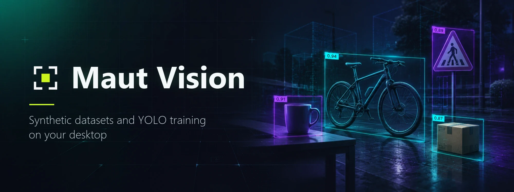
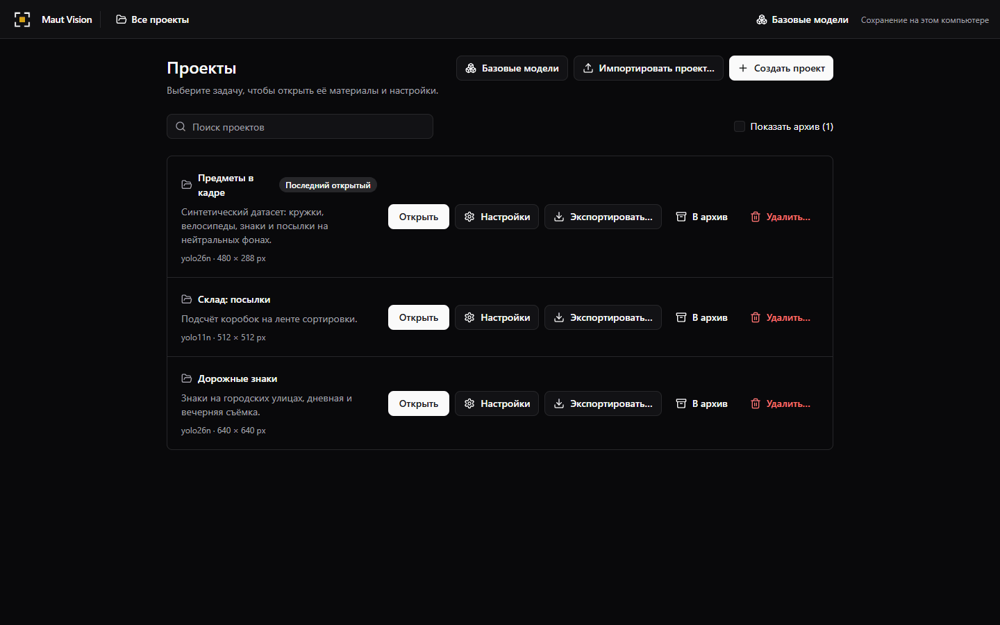
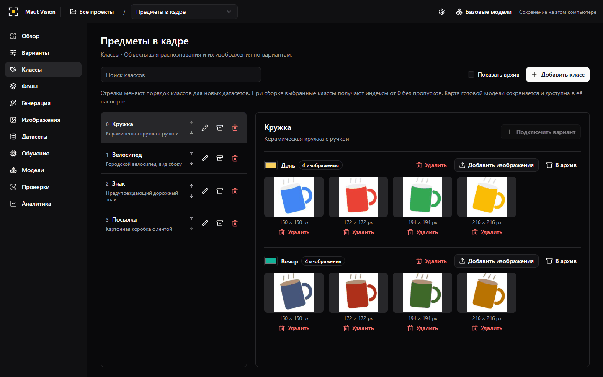
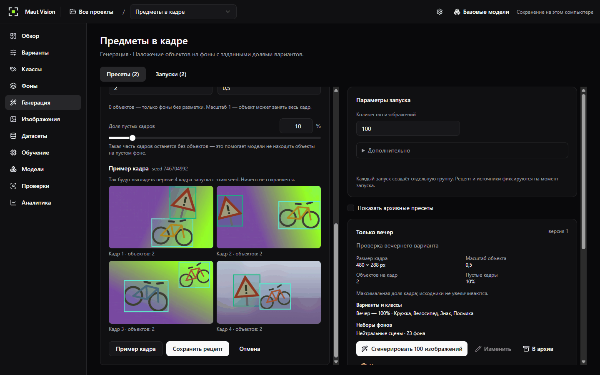
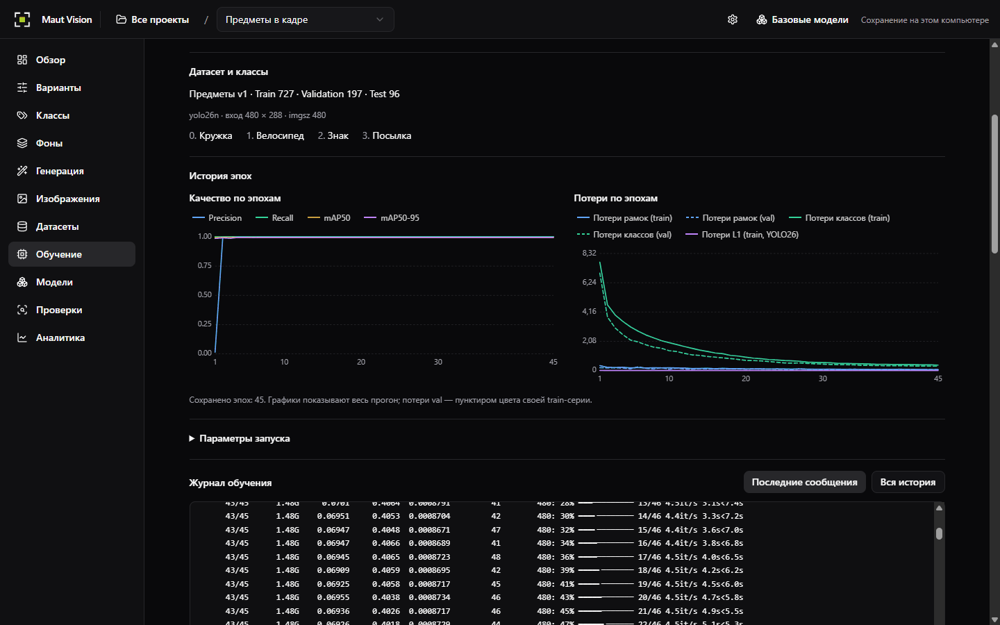
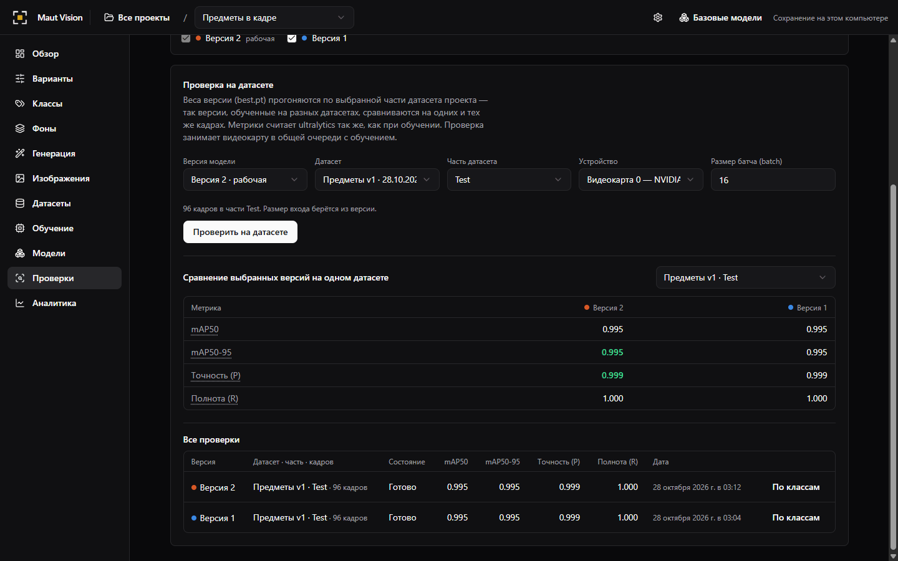
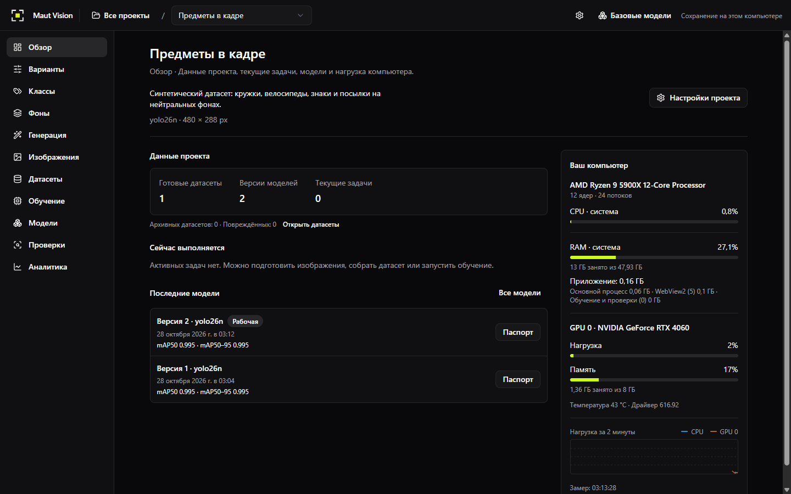
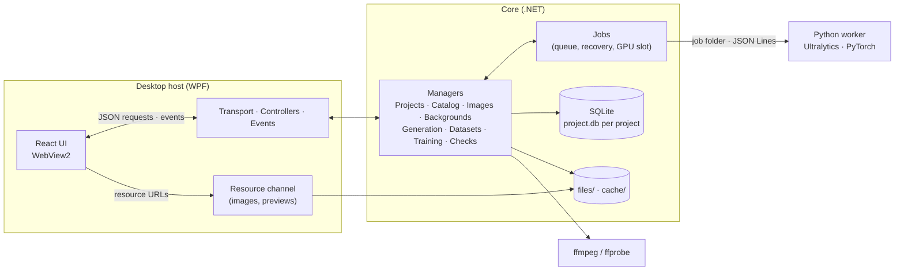

<p align="center">
  
</p>

<h1 align="center">Maut Vision</h1>

<p align="center">
  <b>Build synthetic datasets, train YOLO detectors and check them — in one desktop application.</b>
</p>

<p align="center">
  <a href="CHANGELOG.md"></a>
  <a href="LICENSE"></a>
  
  
  
  
</p>

<p align="center">
  <a href="https://github.com/maut-dev/maut-vision/stargazers"></a>
  <a href="https://github.com/maut-dev/maut-vision/network/members"></a>
  <a href="https://github.com/maut-dev/maut-vision/issues"></a>
  <a href="https://github.com/maut-dev/maut-vision/commits/master"></a>
</p>

<p align="center">
  <a href="#installation">Download</a> ·
  <a href="#features">Features</a> ·
  <a href="#screenshots">Screenshots</a> ·
  <a href="docs/overview.md">Documentation</a> ·
  <a href="CONTRIBUTING.md">Contributing</a> ·
  <a href="README.ru.md">Русский</a>
</p>

---

**Maut Vision** is a free, open-source Windows application for the whole object detection workflow: describe the objects you need,
turn a handful of cut-out images into thousands of annotated synthetic frames, build a clean YOLO dataset, train an Ultralytics model on
your NVIDIA GPU and check it on images, videos and a live screen region. Everything runs locally — no cloud account, no uploads, no
command line.

> [!NOTE]
> The interface is available in **English** and **Russian**: switch the language in the header; by default it follows the language of
> Windows. The documentation and the code are in English.

## Features

| | |
|---|---|
| 🗂️ **Projects** | A project library with the base model and input size per project, archive, last opened project, export to a ZIP archive and import with integrity checks. |
| 🏷️ **Classes and variants** | Classes of objects with appearance variants (day, evening, mock-up…), colours and order that defines YOLO indexes; source images with transparency per class variant. |
| 🖼️ **Images and annotation** | Image groups with train/validation/test hints, import of files, folders and video frames, a virtualized gallery for hundreds of thousands of frames and an annotation editor with boxes, ROI and undo. |
| 🌄 **Backgrounds** | Background sets from ready frames, crops of large images and **video frames via ffmpeg**, deterministic blur and similarity filtering. |
| ✨ **Synthetic generation** | Presets that place class objects on backgrounds with variant shares, objects per frame, empty frames and scale; sample frames before the run; resumable parallel runs that produce annotated images. |
| 📦 **Datasets** | Build plans with skip reasons and warnings, deterministic splits without leakage of identical pixels, immutable YOLO dataset versions with **SHA-256 integrity checks** and ZIP export. |
| 🚀 **Training** | **Ultralytics YOLO** detection training on an **NVIDIA GPU** (or the CPU) with the full parameter set and presets, a live run passport with epoch charts and console log, recovery after an application restart. |
| 🧠 **Model versions** | Versions with metrics, parameters, plots and a working version; `best.pt` and **`best.onnx`** export as a reproducible ZIP. |
| 🔍 **Checks** | Evaluation on a dataset split with a comparison matrix, and live checks on an **image, a video or a screen region** with boxes and a detection journal. |
| 📊 **Overview and analytics** | Project data, running work, latest models, CPU/GPU/RAM load, and a side-by-side comparison of model versions with training curves. |
| 🖥️ **Desktop comfort** | Tray mode with background jobs, single instance, per-monitor DPI, an event-driven UI without polling, structured logs. |

## Screenshots

<table>
  <tr>
    <td width="50%"><br><sub><b>Project library</b></sub></td>
    <td width="50%"><br><sub><b>Classes and variants</b></sub></td>
  </tr>
  <tr>
    <td width="50%"><br><sub><b>Synthetic generation with sample frames</b></sub></td>
    <td width="50%"><br><sub><b>Training run with epoch charts</b></sub></td>
  </tr>
  <tr>
    <td width="50%"><br><sub><b>Model versions compared on a dataset split</b></sub></td>
    <td width="50%"><br><sub><b>Project overview</b></sub></td>
  </tr>
</table>

## Performance

Maut Vision is built to stay fast on large libraries:

- ⚡ **A library of 250,000 image files is ready in ~1.1 s** after start; opening a project takes under a second, the first page of a
  gallery under 300 ms ([measurements](docs/Code/review-and-testing.md#performance)).
- 🧮 **SIMD/AVX2 hot paths** — background similarity, hashing and CRC use hardware intrinsics with scalar fallbacks.
- 🔔 **Event-driven UI** — screens apply Core events instead of polling; images travel through a dedicated resource channel, not through
  JSON messages.
- 🔗 **Hard links instead of copies** — datasets, training inputs and project exports reuse files without duplicating gigabytes.

## Installation

> [!IMPORTANT]
> **Download:** [MautVision-Setup-1.2.0.exe](https://github.com/maut-dev/maut-vision/releases/download/v1.2.0/MautVision-Setup-1.2.0.exe) (1.93 GB)
>
> All versions and release notes: [GitHub Releases](https://github.com/maut-dev/maut-vision/releases).
>
> SHA-256: `966c3a23e646910893a1806a02430b72a500d4a5bdaca31aeb5516977ff6509d`

**Verify the download.** Compare the SHA-256 of the installer with the hash published next to the download link:

```powershell
Get-FileHash .\MautVision-Setup-1.2.0.exe -Algorithm SHA256
```

The installer is not code-signed yet, so Windows SmartScreen may ask for confirmation ("More info" → "Run anyway"). Install only a file
whose hash matches.

### Requirements

| | |
|---|---|
| OS | Windows 10 or 11, 64-bit |
| Disk | ~4 GB for the application (the bundled Python ML runtime) plus space for your projects |
| WebView2 | Microsoft Edge WebView2 Runtime — installed automatically if missing |
| GPU (optional) | NVIDIA GPU with a driver that supports **CUDA 13** for GPU training and checks; without it training runs on the CPU |

The installer works per user without administrator rights, installs into `%LOCALAPPDATA%\Programs\MautVision` and keeps your data in
`%LOCALAPPDATA%\MautVision`. A new version installs over the old one; uninstalling keeps your projects unless you choose to remove them.

## Quick start

1. **Create a project** in the library: a name, a base model (for example `yolo26n`) and the input size. Install the base model on the
   "Base models" screen — it is downloaded once and verified by SHA-256.
2. **Describe the objects** in "Classes": add variants (for example "Day" and "Evening"), create classes and upload a few cut-out PNG
   images with transparency for each class variant.
3. **Add backgrounds**: ready frames of the input size, crops of larger pictures or frames from a video.
4. **Generate** annotated frames in "Generation": choose backgrounds, variant shares, objects per frame and scale; check the sample frames
   and start the run.
5. **Build a dataset** in "Datasets": select groups and classes, review the plan and build an immutable YOLO version.
6. **Train** in "Training": pick the dataset, the device and parameters (or a preset) and follow the epochs live.
7. **Check the model** in "Checks" on a dataset split, an image, a video or a screen region, compare versions in "Analytics" and export
   `best.pt` / `best.onnx` from "Models".

## Use with AI assistants (MCP)

Maut Vision has a local [Model Context Protocol](https://modelcontextprotocol.io) server, so an AI assistant on the same computer — Claude
Code, Claude Desktop, Cursor and other MCP clients — can work with your projects: create classes and import images, look at frames and fix
annotation, build backgrounds, generate and build datasets, train, evaluate and compare models, and run image, video and screen checks. It
uses the same Core as the window, so everything the assistant does appears in the application as it happens, and jobs it starts are marked
"AI (client) · …".

**Turn it on**: the robot button in the header opens "AI assistants (MCP)". Switch the server on; it listens only on `127.0.0.1` (port 46100,
or a free port of 39100–39999 when Windows reserves it) and generates a secret token. The dialog has **Copy** buttons with ready
configurations that already contain your port, token and paths.

- **Claude Code** (Streamable HTTP):

  ```powershell
  claude mcp add --transport http maut-vision http://127.0.0.1:46100/mcp --header "Authorization: Bearer <token>"
  ```

  or the same server in a project's `.mcp.json`:

  ```json
  { "mcpServers": { "maut-vision": { "type": "http", "url": "http://127.0.0.1:46100/mcp", "headers": { "Authorization": "Bearer <token>" } } } }
  ```

- **Claude Desktop** starts commands, so it uses the stdio proxy `maut-vision-mcp.exe` installed next to the application. Add to
  `%APPDATA%\Claude\claude_desktop_config.json`:

  ```json
  { "mcpServers": { "maut-vision": { "command": "C:\Users\<you>\AppData\Local\Programs\MautVision\maut-vision-mcp.exe", "args": [] } } }
  ```

  The proxy reads the port and token from the settings of the application (no token in the config). When Maut Vision is closed, it starts
  it in the notification area ("Start the application when the AI asks", on by default).

**Access levels**: *Read only* (lists, details, views), *Read and change* (also creating, importing, generating, training) and *Full
access* (also deleting and overwriting files; the default). Deleting a project, capturing the screen and starting a screen check always wait for
your «Allow» in the window. Paths can be limited to chosen folders; the dialog also shows the log of the last 500 calls.

> [!IMPORTANT]
> **Privacy.** The server never leaves your computer, but whatever the assistant reads — names, metrics and the **images it views** with
> `view`, `predict_image` or `capture_screen` — is sent to the provider of the AI model you use, under that provider's terms. Use the
> *Read only* level or the folder restriction when that matters.

Tools, resources, prompts and the rules of the server: [docs/Desktop/mcp.md](docs/Desktop/mcp.md).

## Tech stack

| Layer | Technologies |
|---|---|
| Desktop host | C# 14, .NET 10, WPF, WebView2, WinForms tray |
| Core | .NET 10, SQLite (Microsoft.Data.Sqlite) per project, SkiaSharp, System.Numerics / AVX2 intrinsics |
| UI | React, TypeScript, Vite, Tailwind CSS, shadcn/ui, Radix UI |
| ML worker | Python 3.14, PyTorch (CUDA 13), Ultralytics YOLO, OpenCV, ONNX, mss, PyInstaller |
| Media | FFmpeg / ffprobe (LGPL build) |
| Delivery | Inno Setup 6, self-contained ReadyToRun publish |

## Architecture



- **Core** holds all business logic behind public interfaces; managers are independent, and scenarios spanning several managers run as
  persistent, resumable **jobs**.
- **Desktop** shows a loading window, initializes Core and hosts the React UI in WebView2; controllers map Core contracts to DTOs.
- **Python worker** runs one ML operation per process on a job folder (`request.json` → JSON Lines events → `result.json`), offline and
  inside a Windows Job Object.

Read more in the [architecture overview](docs/overview.md) ([на русском](docs/ru/README.md)).

## Development

### Prerequisites

Windows 10/11 x64, [.NET 10 SDK](https://dotnet.microsoft.com/download), [Node.js](https://nodejs.org/) LTS with npm, WebView2 Runtime,
Python 3.14 x64 for training and checks, optionally an NVIDIA GPU with a CUDA 13 driver and [Inno Setup 6.5+](https://jrsoftware.org/isinfo.php)
for the installer.

### Build and run

```powershell
git clone https://github.com/maut-dev/maut-vision.git
cd maut-vision
.\tools\setup-python.ps1        # .dev/python-venv from python/requirements.txt (several GB, once)
.\start.ps1                     # builds UI and solution, starts the app with .dev/DevWorkDirectory
```

| Command | Purpose |
|---|---|
| `.\start.ps1 [-NoLaunch] [-WorkDirectory <dir>] [-Python <python.exe>]` | build the UI and the solution and start the application |
| `.\smoke.ps1 [-SkipBuild]` | Core, page and host checks with a fake Python worker |
| `npm --prefix ui run typecheck` | TypeScript checks |
| `.\perf.ps1` | performance measurement on a generated library of 250,000 files |
| `.\build-installer.ps1 [-PublishOnly]` | self-contained publish and the Inno Setup installer; prints its SHA-256 |
| `.\tools\verify-install.ps1` | silent install, files, update and uninstall checks of a test installer |
| `.\tools\run-e2e.ps1` | end-to-end scenario (training on the GPU) on an installed test build |

Documentation: [architecture](docs/overview.md) · [code style](docs/Code/style.md) · [testing](docs/Code/review-and-testing.md) ·
[Git and releases](docs/Code/git.md) · [Python worker](python/README.md) · [packaging](docs/Desktop/appdata-and-packaging.md).

## Contributing

Contributions are welcome! Please read [CONTRIBUTING.md](CONTRIBUTING.md) and the [Code of Conduct](CODE_OF_CONDUCT.md). Report bugs and
ideas in [issues](https://github.com/maut-dev/maut-vision/issues); report security problems privately as described in
[SECURITY.md](SECURITY.md).

## Versioning and branches

Maut Vision follows [Semantic Versioning](https://semver.org/) — `MAJOR.MINOR.PATCH`, and every release is recorded in the
[changelog](CHANGELOG.md).

- `master` — released versions, each tagged `vX.Y.Z`;
- `dev` — linear development, the target of pull requests;
- `feature/*`, `fix/*`, `docs/*`, `refactor/*` — work branches from `dev`;
- `release/x.y.z` and `hotfix/x.y.z` — release preparation and urgent fixes.

## License

Maut Vision is licensed under the [GNU Affero General Public License v3.0](LICENSE). The Python worker uses
[Ultralytics YOLO](https://github.com/ultralytics/ultralytics), which is also distributed under AGPL-3.0; commercial use that cannot
comply with the AGPL requires an appropriate license from Ultralytics as well.

The installer bundles third-party components — .NET, WebView2, SkiaSharp, SQLite, React and others, the LGPL build of FFmpeg, PyTorch and
the Python runtime packages — under their own licenses; see [THIRD-PARTY-NOTICES.txt](THIRD-PARTY-NOTICES.txt). Base model weights are
downloaded from their official sources on demand and are subject to their licenses.

## Star history

<a href="https://star-history.com/#maut-dev/maut-vision&Date">
  <picture>
    <source media="(prefers-color-scheme: dark)" srcset="https://api.star-history.com/svg?repos=maut-dev/maut-vision&type=Date&theme=dark">
    
  </picture>
</a>

<p align="center"><sub>If Maut Vision is useful to you, consider giving it a ⭐ — it helps others find the project.</sub></p>
