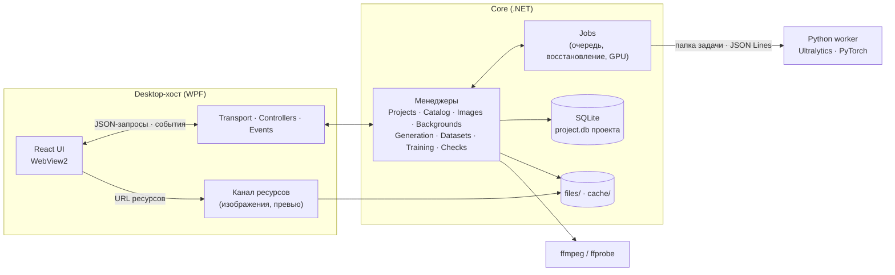

<p align="center">
  
</p>

<h1 align="center">Maut Vision</h1>

<p align="center">
  <b>Синтетические датасеты, обучение детекторов YOLO и их проверка — в одном настольном приложении.</b>
</p>

<p align="center">
  <a href="CHANGELOG.md"></a>
  <a href="LICENSE"></a>
  
  
  
  
</p>

<p align="center">
  <a href="https://github.com/maut-dev/maut-vision/stargazers"></a>
  <a href="https://github.com/maut-dev/maut-vision/network/members"></a>
  <a href="https://github.com/maut-dev/maut-vision/issues"></a>
  <a href="https://github.com/maut-dev/maut-vision/commits/master"></a>
</p>

<p align="center">
  <a href="#установка">Скачать</a> ·
  <a href="#возможности">Возможности</a> ·
  <a href="#снимки-экрана">Снимки экрана</a> ·
  <a href="docs/ru/README.md">Архитектура</a> ·
  <a href="CONTRIBUTING.md">Участие</a> ·
  <a href="README.md">English</a>
</p>

---

**Maut Vision** — бесплатное приложение с открытым исходным кодом для Windows, которое закрывает весь путь детекции объектов: опишите
нужные объекты, превратите несколько вырезанных изображений в тысячи размеченных синтетических кадров, соберите чистый датасет YOLO,
обучите модель Ultralytics на видеокарте NVIDIA и проверьте её на изображениях, видео и области экрана. Всё работает локально — без
облачных аккаунтов, загрузок и командной строки.

> [!NOTE]
> Интерфейс версии 1.0 — на **русском** языке. Английская локализация запланирована в следующих версиях. Документация и код — на
> английском, краткий русский обзор архитектуры — в [docs/ru/README.md](docs/ru/README.md).

## Возможности

| | |
|---|---|
| 🗂️ **Проекты** | Библиотека проектов: базовая модель и размер входа, архив, последний открытый проект, экспорт в ZIP и импорт с проверкой целостности. |
| 🏷️ **Классы и варианты** | Классы объектов с вариантами внешнего вида (день, вечер, макет…), цветами и порядком, задающим индексы YOLO; исходные изображения с прозрачностью для каждого варианта класса. |
| 🖼️ **Изображения и разметка** | Группы с назначением train/validation/test, импорт файлов, папок и кадров видео, виртуальная галерея на сотни тысяч кадров и редактор разметки с рамками, ROI и отменой. |
| 🌄 **Фоны** | Наборы фонов из готовых кадров, вырезов больших изображений и **кадров видео через ffmpeg**, детерминированное размытие и отсев похожих кадров. |
| ✨ **Синтетическая генерация** | Пресеты: объекты классов на фонах с долями вариантов, числом объектов, пустыми кадрами и масштабом; пример кадра до запуска; возобновляемые параллельные запуски с готовой разметкой. |
| 📦 **Датасеты** | План сборки с причинами пропусков и предупреждениями, детерминированное разбиение без утечки одинаковых пикселей, неизменяемые версии YOLO с **проверкой целостности по SHA-256** и экспортом ZIP. |
| 🚀 **Обучение** | Обучение детекции **Ultralytics YOLO** на **видеокарте NVIDIA** (или процессоре) с полным набором параметров и пресетами, живой паспорт запуска с графиками эпох и журналом, восстановление после перезапуска. |
| 🧠 **Версии моделей** | Версии с метриками, параметрами, графиками и рабочей версией; выгрузка `best.pt` и **`best.onnx`** в воспроизводимый ZIP. |
| 🔍 **Проверки** | Оценка на части датасета с матрицей сравнения и живые проверки на **изображении, видео и области экрана** с рамками и журналом обнаружений. |
| 📊 **Обзор и аналитика** | Данные проекта, идущие задачи, последние модели, нагрузка CPU/GPU/RAM и сравнение версий моделей с кривыми обучения. |
| 🖥️ **Удобство** | Работа в области уведомлений с фоновыми задачами, единственный экземпляр, масштаб по монитору, интерфейс на событиях без опроса, журналы. |

## Снимки экрана

<table>
  <tr>
    <td width="50%"><br><sub><b>Библиотека проектов</b></sub></td>
    <td width="50%"><br><sub><b>Классы и варианты</b></sub></td>
  </tr>
  <tr>
    <td width="50%"><br><sub><b>Генерация с примером кадра</b></sub></td>
    <td width="50%"><br><sub><b>Запуск обучения с графиками эпох</b></sub></td>
  </tr>
  <tr>
    <td width="50%"><br><sub><b>Сравнение версий на части датасета</b></sub></td>
    <td width="50%"><br><sub><b>Обзор проекта</b></sub></td>
  </tr>
</table>

## Производительность

- ⚡ **Библиотека на 250 000 файлов изображений готова примерно за 1,1 с** после запуска; проект открывается быстрее секунды, первая
  страница галереи — быстрее 300 мс ([замеры](docs/Code/review-and-testing.md#performance)).
- 🧮 **SIMD/AVX2 в горячих путях** — сравнение фонов, хеши и CRC используют аппаратные инструкции с запасным скалярным путём.
- 🔔 **Интерфейс на событиях** — экраны применяют события Core вместо опроса; изображения идут по отдельному каналу ресурсов, а не в
  JSON-сообщениях.
- 🔗 **Жёсткие ссылки вместо копий** — датасеты, входы обучения и экспорт проектов не дублируют гигабайты файлов.

## Установка

> [!IMPORTANT]
> **Скачать:** [MautVision-Setup-1.0.0.exe](DOWNLOAD_URL) <!-- DOWNLOAD_URL: заменить ссылкой на выпуск перед публикацией -->
>
> Пока выпуски распространяются по ссылке для скачивания; позже появятся сайт и выпуски на GitHub.

**Проверьте файл.** Сравните SHA-256 установщика с хешем, опубликованным рядом со ссылкой:

```powershell
Get-FileHash .\MautVision-Setup-1.0.0.exe -Algorithm SHA256
```

Установщик пока не подписан, поэтому Windows SmartScreen может попросить подтверждение («Подробнее» → «Выполнить в любом случае»).
Устанавливайте только файл с совпадающим хешем.

### Требования

| | |
|---|---|
| ОС | Windows 10 или 11, 64-бит |
| Диск | ~4 ГБ для приложения (встроенная среда Python для ML) и место для проектов |
| WebView2 | Microsoft Edge WebView2 Runtime — ставится автоматически, если его нет |
| Видеокарта (необязательно) | NVIDIA с драйвером, поддерживающим **CUDA 13**, для обучения и проверок на GPU; без неё обучение идёт на процессоре |

Установщик работает без прав администратора, ставит программу в `%LOCALAPPDATA%\Programs\MautVision`, а данные хранит в
`%LOCALAPPDATA%\MautVision`. Новая версия ставится поверх старой; удаление программы сохраняет проекты, если вы не выберете иное.

## Быстрый старт

1. **Создайте проект** в библиотеке: название, базовая модель (например, `yolo26n`) и размер входа. Установите базовую модель на экране
   «Базовые модели» — она скачивается один раз и проверяется по SHA-256.
2. **Опишите объекты** в разделе «Классы»: добавьте варианты (например, «День» и «Вечер»), создайте классы и загрузите несколько
   вырезанных PNG с прозрачностью для каждого варианта класса.
3. **Добавьте фоны**: готовые кадры размера входа, вырезы из больших изображений или кадры видео.
4. **Сгенерируйте** размеченные кадры в разделе «Генерация»: фоны, доли вариантов, число объектов и масштаб; посмотрите пример кадра и
   запустите.
5. **Соберите датасет** в разделе «Датасеты»: выберите группы и классы, проверьте план и соберите неизменяемую версию YOLO.
6. **Обучите** модель в разделе «Обучение»: датасет, устройство и параметры (или пресет), эпохи видны вживую.
7. **Проверьте модель** в разделе «Проверки» на датасете, изображении, видео или экране, сравните версии в «Аналитике» и выгрузите
   `best.pt` / `best.onnx` из «Моделей».

## Технологии

| Слой | Технологии |
|---|---|
| Desktop-хост | C# 14, .NET 10, WPF, WebView2, трей WinForms |
| Core | .NET 10, SQLite (Microsoft.Data.Sqlite) на проект, SkiaSharp, System.Numerics / AVX2 |
| UI | React, TypeScript, Vite, Tailwind CSS, shadcn/ui, Radix UI |
| ML worker | Python 3.14, PyTorch (CUDA 13), Ultralytics YOLO, OpenCV, ONNX, mss, PyInstaller |
| Медиа | FFmpeg / ffprobe (сборка LGPL) |
| Поставка | Inno Setup 6, self-contained ReadyToRun |

## Архитектура



Подробнее — [обзор архитектуры на русском](docs/ru/README.md) и [английская документация](docs/overview.md).

## Разработка

Нужны Windows 10/11 x64, [.NET 10 SDK](https://dotnet.microsoft.com/download), [Node.js](https://nodejs.org/) LTS с npm, WebView2 Runtime,
Python 3.14 x64 для обучения и проверок, по желанию видеокарта NVIDIA с драйвером CUDA 13 и [Inno Setup 6.5+](https://jrsoftware.org/isinfo.php)
для установщика.

```powershell
git clone https://github.com/maut-dev/maut-vision.git
cd maut-vision
.\tools\setup-python.ps1        # .dev/python-venv из python/requirements.txt (несколько ГБ, один раз)
.\start.ps1                     # сборка UI и решения, запуск с рабочей папкой .dev/DevWorkDirectory
```

| Команда | Назначение |
|---|---|
| `.\start.ps1 [-NoLaunch] [-WorkDirectory <папка>] [-Python <python.exe>]` | сборка UI и решения, запуск приложения |
| `.\smoke.ps1 [-SkipBuild]` | проверки Core, страницы и хоста с поддельным Python worker |
| `npm --prefix ui run typecheck` | проверка TypeScript |
| `.\perf.ps1` | замер производительности на библиотеке из 250 000 файлов |
| `.\build-installer.ps1 [-PublishOnly]` | публикация и установщик Inno Setup; печатает SHA-256 |
| `.\tools\verify-install.ps1` | проверка тихой установки, файлов, обновления и удаления тестового установщика |
| `.\tools\run-e2e.ps1` | сквозной сценарий (обучение на GPU) на установленной тестовой сборке |

## Участие

Мы рады вкладу! Прочитайте [CONTRIBUTING.md](CONTRIBUTING.md) и [Кодекс поведения](CODE_OF_CONDUCT.md). Ошибки и идеи —
в [issues](https://github.com/maut-dev/maut-vision/issues); уязвимости — только приватно, см. [SECURITY.md](SECURITY.md).

## Версии и ветки

Версии следуют [семантическому версионированию](https://semver.org/lang/ru/) `MAJOR.MINOR.PATCH`, каждый выпуск описан в
[CHANGELOG.md](CHANGELOG.md). Ветки: `master` — выпуски с тегами `vX.Y.Z`; `dev` — линейная разработка; `feature/*`, `fix/*`, `docs/*`,
`refactor/*` — рабочие ветки от `dev`; `release/x.y.z` и `hotfix/x.y.z` — подготовка выпуска и срочные исправления.

## Лицензия

Maut Vision распространяется по [GNU Affero General Public License v3.0](LICENSE). Python worker использует
[Ultralytics YOLO](https://github.com/ultralytics/ultralytics), который тоже распространяется по AGPL-3.0; коммерческое использование,
несовместимое с AGPL, требует отдельной лицензии Ultralytics.

Установщик содержит сторонние компоненты — .NET, WebView2, SkiaSharp, SQLite, React и другие, LGPL-сборку FFmpeg, PyTorch и пакеты среды
Python — по их собственным лицензиям; см. [THIRD-PARTY-NOTICES.txt](THIRD-PARTY-NOTICES.txt). Веса базовых моделей скачиваются по запросу
из официальных источников и подчиняются их лицензиям.

## История звёзд

<a href="https://star-history.com/#maut-dev/maut-vision&Date">
  <picture>
    <source media="(prefers-color-scheme: dark)" srcset="https://api.star-history.com/svg?repos=maut-dev/maut-vision&type=Date&theme=dark">
    
  </picture>
</a>

<p align="center"><sub>Если Maut Vision вам полезен, поставьте ⭐ — так проект найдут другие.</sub></p>
